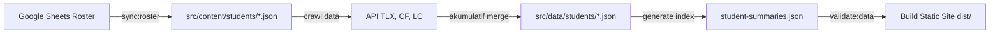

# 🚀 CP JTK Dashboard & Ecosystem

> **Pusat monitoring, analitik latihan, dan ekosistem competitive programming mahasiswa Jurusan Teknik Komputer dan Informatika (JTK) Politeknik Negeri Bandung.**

Dibangun dengan **[Astro](https://astro.build)**, **[Vue 3](https://vuejs.org)** islands, dan **[Tailwind CSS](https://tailwindcss.com)**. Output berupa _fully static site_ performa tinggi yang siap dideploy ke Netlify atau hosting statis lainnya.

---

## 🤝 Yuk, Berkontribusi! (Open for Contributors)

Proyek ini dibangun dari mahasiswa, oleh mahasiswa, dan untuk kemajuan komunitas competitive programming JTK Polban. Kami sangat terbuka terhadap kontribusi dari siapa pun—baik mahasiswa aktif, alumni, maupun kontributor eksternal!

Kamu bisa berkontribusi dalam berbagai bentuk:

- 💡 Mengusulkan fitur baru atau peningkatan alur UX di [Issues](https://github.com/ikajtk/cp-jtk/issues).
- 🐛 Menemukan dan memperbaiki bug di crawler maupun tampilan antarmuka.
- 🎨 Memoles desain UI/UX dan aksesibilitas komponen.
- ⚡ Mengoptimalkan pipeline data, crawler, dan integrasi platform CP.
- 🛠️ Mengerjakan salah satu item dari **Roadmap & Backlog** di bawah ini!

---

## 🗺️ Roadmap & Backlog (TODO)

Berikut adalah daftar prioritas fitur berikutnya yang siap untuk dieksplorasi dan dikerjakan bersama:

### 1. `[HIGH]` Cheatsheet / TRD Generator

> **Generator Team Reference Document (TRD) otomatis untuk bekal bertanding resmi di ajang ICPC, Gemastik, dan kompetisi programming lainnya.**

- **DSA Repository Scanner**: Terhubung langsung ke repositori sumber materi algoritma dan struktur data (`data-structure-and-algorithm`) C++ yang strukturnya tersusun dalam _directory tree_.
- **Interactive Algorithm Picker**: Antarmuka web yang memindai tree direktori tersebut dan memungkinkan peserta memilih secara fleksibel algoritma/template kode mana saja yang ingin disertakan ke dalam dokumen TRD.
- **Team Info & Custom Branding**: Form konfigurasi informasi tim (nama tim, asal kampus/institusi, dan logo tim).
- **Live Preview**: Pratinjau layout dokumen TRD yang dipilih sebelum diekspor.
- **Export Pipeline**: Pipeline build (berbasis Node.js atau generator LaTeX seperti Python x XeLaTeX) untuk meng-compile kode terpilih menjadi dokumen PDF siap cetak: multi-kolom rapi, nomor halaman, syntax highlighting monokrom/kontras, dan indeks/daftar isi otomatis sesuai regulasi kompetisi.

### 2. `[HIGH]` Judgels / DOMjudge Integration

> **Integrasi penilaian langsung dari sistem online judge internal milik JTK Polban.**

- **Status**: ⏳ _Waiting for Sponsors / Server Support_ (sedang menunggu ketersediaan infrastruktur server/resource hosting untuk menjalankan instance judge internal secara stabil).
- **Deskripsi**: Menghubungkan dashboard dengan autograder internal (Judgels atau DOMjudge) agar aktivitas latihan lokal, praktikum, maupun kontes internal kampus dapat tercatat langsung di heatmap dan metrik mahasiswa bersama platform publik lainnya.

### 3. `[LOW]` Smart Team Generator

> **Matchmaking cerdas untuk pembentukan tim competitive programming yang seimbang dan komplementer.**

- **Skill-Pattern Matching**: Menganalisis pola problem-solving tiap mahasiswa berdasarkan tag kategori soal yang sering diselesaikan (misalnya: spesialis Dynamic Programming, Graph Theory, Number Theory/Math, Data Structures, Greedy, dll.).
- **Regenerasi & Mentoring**: Penyeimbangan tim berbasis angkatan/tingkat kelas (menggabungkan senior dengan junior untuk transfer ilmu dan regenerasi kontestan).
- **Diversitas Akademik**: Distribusi seimbang lintas kelas dan program studi (D3 & D4).

---

## 📌 Status Proyek Saat Ini (MVP)

Dashboard saat ini berada pada tahap **Cohort MVP** dengan kapabilitas:

1. **Roster Otomatis**: Daftar mahasiswa disinkronkan dari Google Sheets publik ke `src/content/students/<nim>.json`.
2. **Snapshot Akumulatif**: Data aktivitas latihan dikoleksi berkala dan tersimpan di `src/data/students/<nim>.json` dengan mekanisme penggabungan (_append-only_).
3. **Cohort Explorer**: Landing page di `/` dilengkapi pencarian instan, filter multi-dimensi (Prodi D3/D4, Tingkat 1-4 & Alumni), KPI latihan, dan sortir dinamis.
4. **Student Detail Page**: Halaman personal di `/students/<nim>/` dengan kalender aktivitas heatmap (GitHub-style), ringkasan metrik platform, breakdown submission, dan riwayat problem solved.
5. **Multi-Platform Support**: Integrasi profil dan riwayat submission dari **TLX**, **Codeforces**, dan **LeetCode**.

---

## 🛠️ How to Contribute

Ikuti panduan berikut untuk mulai berkontribusi secara lokal:

### 1. Prasyarat Sistem

- **Node.js**: `v20.x` atau `v22.x+` (disarankan LTS).
- **npm**: paket bawaan Node.js.
- **Git**

### 2. Quick Start

```sh
# 1. Clone repository (atau fork terlebih dahulu)
git clone https://github.com/ikajtk/cp-jtk.git
cd cp-jtk

# 2. Pasang dependensi
npm install

# 3. Siapkan environment file
cp .env.example .env
# (Opsional) Isi STUDENT_SHEET_CSV_URL jika ingin menguji sinkronisasi roster

# 4. Jalankan development server
npm run dev
```

Buka `http://localhost:4321` di browser kamu untuk melihat dashboard lokal.

### 3. Alur Pengembangan & Git Workflow

1. Buat branch baru dari `main`:
   ```sh
   git checkout -b feat/nama-fitur-kamu
   # atau
   git checkout -b fix/deskripsi-perbaikan
   ```
2. Kerjakan perubahan. Mohon perhatikan panduan teknis:
   - Gunakan CSS variables dan semantic tokens yang ada di `src/styles/tokens.css`.
   - Pertahankan arsitektur static Astro + Vue islands tanpa menambah JavaScript runtime yang tidak diperlukan.
   - Tulis seluruh teks antarmuka (_user-facing copy_) dalam **bahasa Indonesia**.
3. Format file yang kamu ubah dengan Prettier:
   ```sh
   npx prettier --write <file-yang-diubah>
   ```
4. Jalankan pengujian lokal sebelum mengajukan PR:
   ```sh
   npm run check       # Memeriksa diagnostik TypeScript, Astro, dan Vue
   npm test            # Menjalankan unit tests (Vitest)
   npm run build       # Memastikan static build berhasil tanpa error
   ```
5. Buat commit dengan format **Conventional Commits**:
   - `feat(cohort): tambah opsi filter baru`
   - `fix(heatmap): perbaiki warna select di light mode`
   - `docs(readme): lengkapi petunjuk kontribusi`
6. Push branch ke repository fork kamu dan buat **Pull Request (PR)** dengan deskripsi perubahan yang jelas.

---

## 💻 Daftar Perintah (Scripts)

| Perintah                | Deskripsi                                                                 |
| :---------------------- | :------------------------------------------------------------------------ |
| `npm run dev`           | Menjalankan Astro development server (`localhost:4321`).                  |
| `npm run build`         | Membangun situs statis siap produksi ke direktori `dist/`.                |
| `npm run preview`       | Menjalankan preview lokal dari hasil build `dist/`.                       |
| `npm run check`         | Menjalankan `astro check` untuk TypeScript, Astro, dan Vue.               |
| `npm test`              | Menjalankan unit tests dengan Vitest.                                     |
| `npm run test:e2e`      | Menjalankan end-to-end tests dengan Playwright.                           |
| `npm run verify`        | Menjalankan pemeriksaan penuh (format, check, test, validasi, dan build). |
| `npm run sync:roster`   | Mengambil data roster mahasiswa terbaru dari Google Sheets.               |
| `npm run crawl:data`    | Mengambil snapshot aktivitas terbaru dari platform TLX, CF, & LC.         |
| `npm run validate:data` | Memvalidasi integritas data roster, snapshot, dan ringkasan.              |

---

## 🏗️ Struktur Direktori

```text
cp-jtk/
├── .github/workflows/       # Otomasi CI/CD & crawler berkala (GitHub Actions)
├── public/                  # Aset statis & konfigurasi headers Netlify
├── scripts/                 # Script pipeline data (sync-roster, crawl-data, validator)
├── src/
│   ├── components/
│   │   ├── cohort/          # Komponen tabel cohort, search, & filter semantik
│   │   ├── cp/              # Komponen detail CP (stats, platform summary, problems)
│   │   ├── layout/          # Shell layout, navigation bar, header, dan footer
│   │   └── shared/          # Komponen UI bersama (heatmap, stat cards, pagination)
│   ├── content/
│   │   └── students/        # Sumber kebenaran roster mahasiswa (JSON per NIM)
│   ├── data/
│   │   ├── students/        # Snapshot akumulatif aktivitas mahasiswa (JSON per NIM)
│   │   └── student-summaries.json # Index ringkas teroptimasi untuk halaman cohort
│   ├── pages/               # Routing halaman Astro (landing `/` & `/students/[nim]`)
│   ├── styles/              # Design tokens dan global CSS
│   └── utils/               # Helper formatting, platform parser, dan SEO
```

---

## 🔄 Pipeline Data Otomatis

Aktivitas latihan mahasiswa diperbarui secara otomatis menggunakan GitHub Actions tanpa ketergantungan database eksternal:



1. **`sync:roster`**: Membaca CSV dari Google Sheets publik dan memperbarui roster per mahasiswa.
2. **`crawl:data`**: Mengambil statistik dan histori solved problem secara akumulatif (_append-only_).
3. **`validate:data`**: Memastikan konsistensi data sebelum proses kompilasi situs.
4. **Automated Commit**: Workflow `.github/workflows/refresh-data.yml` berjalan terjadwal setiap 6 jam untuk memperbarui data terkini.

---

## 📄 Lisensi

Dikembangkan untuk kemajuan **Komunitas Competitive Programming JTK Polban**. Bebas digunakan, dipelajari, dan dikembangkan untuk kepentingan edukasi.
